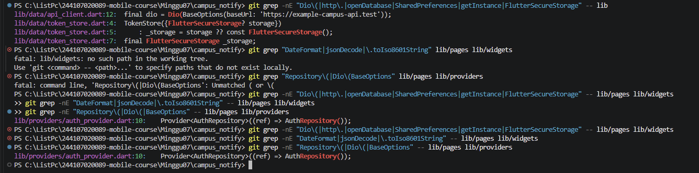
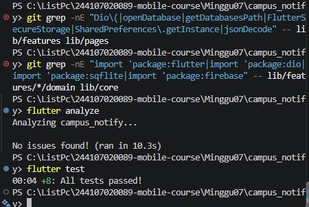

# Week 07 - Clean Architecture

## dio 
sebelum

sesudah

## 7. Refactoring, testing, dan error umum

### Refactoring challenge

Implementasi pada `Minggu07/campus_notify` menggunakan pola yang sama untuk auth dan announcements:

```text
presentation -> domain <- data
```

- `domain` berisi entity, repository contract, dan use case.
- `data` berisi datasource, model, dan repository implementation.
- `presentation` berisi page dan provider Riverpod.
- Repository dibuat di provider, bukan di widget.

### Utility yang dapat diuji tanpa widget

Formatting tanggal dan parsing route dipusatkan di `lib/core/format.dart`:

- `formatDate` menghasilkan `dd/MM/yyyy`.
- `formatDateTime` menghasilkan `dd/MM/yyyy HH:mm`.
- `parseNotificationRoute` menormalisasi route relatif dan fallback route.

### Normalisasi error

Exception dari repository announcements diubah menjadi `NetworkFailure` atau `LocalFailure` sebelum masuk ke provider. UI hanya membaca `Failure.message` melalui `failureMessage`, sehingga tidak menampilkan exception mentah.

### Bukti pengujian

```text
flutter analyze
No issues found!

flutter test
00:05 +13: All tests passed!
```

Test utility tersedia di `Minggu07/campus_notify/test/core_format_test.dart`. Test domain dengan repository palsu tersedia di `Minggu07/campus_notify/test/get_notes_test.dart` dan mencakup data sukses serta `LocalFailure` tanpa melempar exception. Verifikasi arsitektur lengkap dicatat di [AI Verification Checklist](../../Minggu07/campus_notify/docs/ai-verification-checklist.md).

## Checklist verifikasi mandiri

- [x] Tiga pencarian sterilitas pada layer `presentation` dan `domain` tidak menemukan import infrastructure (`Flutter`, `Dio`, `SQLite`, `Firebase`) atau pembuatan repository langsung.
- [x] Interface repository berada di `domain`, implementasi berada di `data`, dan mapping (`fromMap`/`toEntity`) berada di model.
- [x] Widget tidak menginstansiasi repository; semua dependency feature dibuat melalui provider Riverpod.
- [ ] Bukti screenshot manual sebelum/sesudah refactor masih perlu dilampirkan untuk membuktikan perilaku visual tetap identik.
- [x] `flutter analyze` bersih dan seluruh test lulus.

Pemeriksaan teks dilakukan dengan pencarian rekursif PowerShell `Select-String` karena `rg` tidak tersedia pada environment terminal. Hasil executable terakhir: `flutter analyze` tanpa issue dan `flutter test` `+13` lulus.

## 8. Tugas, refleksi, dan referensi

### Mini project / Industry Challenge

Project Week 5-6 `campus_notify` direfactor menjadi Clean Architecture feature-first tanpa membuat project baru. Fitur yang dipisahkan adalah auth, announcements, notifications, dan notes.

#### Struktur final

```text
lib/
├── app/
│   └── router.dart
├── core/
│   ├── failures.dart
│   ├── format.dart
│   ├── network/api_client.dart
│   └── storage/token_store.dart
└── features/
		├── auth/
		│   ├── data/
		│   ├── domain/
		│   └── presentation/
		├── announcements/
		│   ├── data/
		│   ├── domain/
		│   └── presentation/
		├── notes/
		│   ├── data/
		│   ├── domain/
		│   └── presentation/
		└── notifications/
				├── data/
				└── presentation/
```

Aturan dependency yang diterapkan:

```text
presentation -> domain <- data
presentation/data -> core
domain -/-> Flutter, Dio, SQLite, Firebase
```

#### Usulan AI versus keputusan final

| Usulan | Keputusan final | Alasan teknis |
|---|---|---|
| Memisahkan auth dan announcements menjadi feature-first | Diterapkan | Fitur lebih mudah ditemukan dan perubahan datasource tidak menyebar ke widget. |
| Membuat datasource remote terpisah dari repository | Diterapkan | Repository tetap menjadi batas domain; detail Dio/mock berada di data. |
| Memindahkan API client dan token storage ke `core` | Diterapkan | Komponen lintas fitur tidak dimiliki oleh satu halaman. |
| Membuat use case untuk setiap operasi CRUD | Tidak diterapkan secara membabi buta | Use case hanya dipakai untuk operasi bermakna: login, daftar/detail pengumuman, dan get notes. |
| Menghapus semua folder lama sekaligus | Tidak diterapkan | Compatibility facade dipertahankan agar import dan test lama tetap berjalan selama migrasi. |
| Menggunakan package DI tambahan | Tidak diterapkan | Riverpod sudah cukup untuk composition root dan override saat test. |

#### Dependency injection

Repository dibuat di provider Riverpod. Widget hanya menggunakan `ref.watch` atau `ref.read`.

```dart
final announcementRepositoryProvider = Provider<AnnouncementRepository>((ref) {
	return AnnouncementRepositoryImpl(
		ref.watch(announcementRemoteDataSourceProvider),
	);
});

final announcementsProvider = FutureProvider<List<Announcement>>((ref) {
	return ref.watch(getAnnouncementsProvider).call().then((result) {
		if (result.failure != null) throw result.failure!;
		return result.announcements;
	});
});
```

#### Testing

Minimal dua test domain dengan repository palsu tersedia di [get_notes_test.dart](../../Minggu07/campus_notify/test/get_notes_test.dart):

1. Use case meneruskan daftar notes dari repository palsu.
2. Use case meneruskan `LocalFailure` tanpa melempar exception.

Test tambahan di [core_format_test.dart](../../Minggu07/campus_notify/test/core_format_test.dart) menguji formatter tanggal, parser route, dan pesan failure tanpa widget.

#### Cara menjalankan

```powershell
cd Minggu07/campus_notify
flutter pub get
flutter analyze
flutter test
flutter run
```

Stack yang digunakan: Flutter, Dart, Riverpod, Dio, GoRouter, Firebase Messaging, Flutter Secure Storage, dan SQLite.

#### Bukti perilaku

Screenshot before/after perlu disimpan per fitur di folder `Laporan/07-week-7-clean-architecture/screenshots/`. Screenshot yang tersedia saat ini mendokumentasikan pemeriksaan dependency Dio; bukti visual per fitur auth dan announcements masih perlu dilengkapi saat aplikasi dijalankan di emulator/device.

### AI Challenge

Prompt utama yang digunakan:

> Refactor project Flutter campus_notify menjadi Clean Architecture feature-first. Pisahkan domain, data, dan presentation untuk auth serta announcements; jangan membuat repository di widget; verifikasi domain bebas dari Flutter/Dio/SQLite/Firebase; gunakan Riverpod sebagai DI; tambahkan test dengan repository palsu.

Keputusan akhir AI ditinjau ulang dengan batasan project: tidak menambah package DI, tidak membuat use case kosong untuk CRUD sederhana, mempertahankan compatibility facade sementara, dan menggunakan `Failure` agar UI tidak menerima exception mentah. Detail verifikasi ada di [ai-verification-checklist.md](../../Minggu07/campus_notify/docs/ai-verification-checklist.md).

### Portfolio push

Artefak Week 7 yang perlu dipertahankan dalam portfolio:

- README laporan ini sebagai ringkasan arsitektur dan refleksi.
- Folder `screenshots/` sebagai bukti before/after.
- Folder `Minggu07/campus_notify/lib/` sebagai implementasi.
- Folder `Minggu07/campus_notify/test/` sebagai bukti kualitas.
- Folder `Minggu07/campus_notify/docs/` sebagai catatan verifikasi AI.

### Refleksi

#### Mengapa interface repository berada di domain?

Domain mendefinisikan kebutuhan bisnis tanpa mengetahui apakah data berasal dari Dio, SQLite, Firebase, atau fake repository. Jika interface diletakkan di data, domain ikut bergantung pada detail teknis dan penggantian sumber data menjadi lebih mahal.

#### Kapan use case benar-benar dibutuhkan?

Use case dibutuhkan saat ada aturan bisnis, orkestrasi beberapa repository, validasi, atau operasi yang dipakai lintas halaman. Untuk CRUD satu baris tanpa aturan tambahan, repository langsung melalui provider lebih sederhana dan cukup.

#### Apa biaya over-engineering?

Setiap lapisan menambah file, boilerplate, dan jumlah titik debugging. Pada tim kecil, biaya terbesar adalah waktu memahami abstraksi yang tidak memberi perilaku baru. Karena itu project ini memakai use case selektif, bukan satu class untuk setiap method CRUD.

#### Bagaimana menilai saran AI?

Saran AI dipakai sebagai hipotesis, bukan keputusan otomatis. Setiap usulan dicek terhadap struktur project, arah dependency, kebutuhan test, hasil `flutter analyze`, dan test runtime. Usulan yang menambah lapisan tanpa manfaat nyata ditolak atau ditunda.

### Referensi

- [Flutter architecture recommendations](https://docs.flutter.dev/app-architecture)
- [Flutter testing documentation](https://docs.flutter.dev/testing)
- [Riverpod documentation](https://riverpod.dev/docs/introduction/getting_started)
- [Dart testing documentation](https://dart.dev/guides/testing)
- [Firebase Cloud Messaging for Flutter](https://firebase.google.com/docs/cloud-messaging/flutter/receive)
