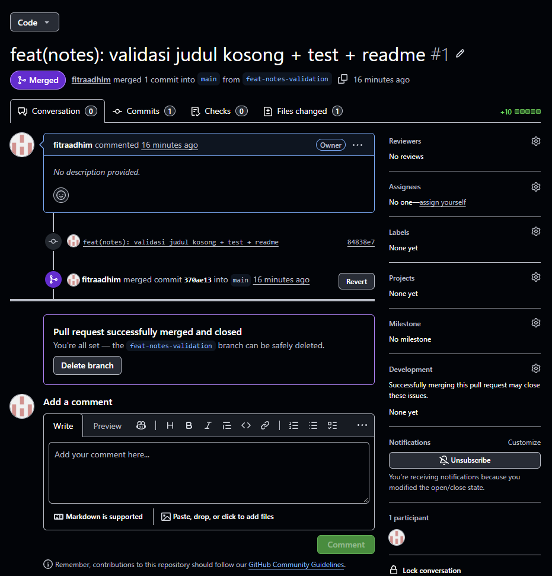

# Week 08 - Mid Project Review

hasil audit riwayat

PR kecil 

nama commit dan isi commit kurang sesuai

## Nilai Kesiapan Tengah Semester

Penilaian tengah semester berfokus pada kesiapan fondasi proyek, bukan hanya
banyaknya fitur. Hasil review dirangkum dalam
[daftar periksa review commit](docs/review-checklist.md).

### Status Pemeriksaan

- [x] Struktur dan riwayat commit ditinjau; tiga pesan commit lama ditulis ulang
      dalam format Conventional Commits beserta alasannya.
- [x] Analisis Flutter bersih dengan `flutter analyze`.
- [x] Pengujian widget berjalan hijau dengan `flutter test`.
- [x] Pull Request kecil telah didokumentasikan melalui screenshot.
- [x] Workflow CI tersedia di
      [`.github/workflows/ci.yml`](../../.github/workflows/ci.yml) untuk
      menjalankan analisis dan test pada setiap Pull Request.
- [ ] Semua komentar review telah ditindaklanjuti dan status PR final telah
      dicatat.

### Definisi Selesai

Mid review dinyatakan selesai apabila aplikasi tetap berjalan sesuai kondisi
akhir Minggu 7, pemeriksaan `flutter analyze` dan `flutter test` berhasil,
minimal satu PR kecil per pasangan telah melalui review, serta README
menyertakan status dan peta issue/PR. Review ini sudah memiliki checklist,
catatan PR, dan bukti pemeriksaan lokal; tindak lanjut komentar reviewer perlu
dicatat setelah proses review selesai.

Yang dinilai bukan banyaknya fitur, melainkan fondasi yang dapat dipercaya untuk
melanjutkan pengembangan pada paruh kedua semester.

## AI Verification Checklist

Hasil review AI tidak langsung diterapkan. Setiap temuan diverifikasi terhadap
kode, hasil test, dan konfigurasi CI. Detail prompt dan lima temuan awal
tersedia di [docs/ai_prompt.md](docs/ai_prompt.md).

### Bukti Verifikasi

- [x] **Temuan CI memakai direktori yang salah terbukti benar.** `pubspec.yaml`
      berada di `Minggu01/my_first_app`, sedangkan workflow menjalankan perintah
      Flutter dari root repository.
- [x] **Temuan dependensi belum di-install terbukti benar.** Workflow tidak
      memiliki langkah `flutter pub get`, sehingga runner baru belum memperoleh
      konfigurasi dependensi sebelum `analyze` dan `test`.
- [x] **Temuan test counter lama terbukti benar.** `test/widget_test.dart`
      masih mencari teks `0`, `1`, dan ikon `add`, sedangkan UI
      `main.dart` menampilkan profil mahasiswa. Saat diverifikasi dengan
      `flutter test`, test gagal karena widget `0` tidak ditemukan.
- [x] **Temuan `flutter analyze` diverifikasi.** Perintah `flutter analyze`
      berhasil pada pemeriksaan lokal dan menghasilkan `No issues found!`.
- [ ] **Workflow CI belum diverifikasi hijau.** Temuan ini belum ditandai
      selesai karena workflow masih perlu diperbaiki dan dijalankan pada
      Pull Request.

### Temuan yang Ditolak

- [x] **Usulan pelanggaran aturan dependency ditolak.** Tidak ada perubahan
      feature-first atau Clean Architecture pada diff ini yang mengimpor
      Flutter, Dio, atau SQLite ke domain. Karena itu, tidak ada bukti untuk
      menolak perubahan berdasarkan aturan arah dependency.
- [x] **Temuan style yang tidak berdampak pada kebenaran ditolak.** Perubahan
      `print` menjadi `debugPrint` tidak dianggap masalah arsitektur atau
      perilaku. Perubahan tersebut justru menghilangkan lint `avoid_print`,
      sehingga tidak perlu ditolak sebagai sekadar preferensi style.

### Keputusan Akhir

Temuan bahwa test lama dan workflow CI belum siap dinyatakan **benar** karena
didukung inspeksi file dan kegagalan test yang dapat direproduksi. Temuan
dependency rule dinyatakan **tidak terbukti** karena diff tidak menyentuh layer
domain, data, atau presentation. PR belum memenuhi definisi selesai sampai
workflow diarahkan ke project Flutter, dependensi di-install, test diperbarui,
dan CI berhasil pada Pull Request.
