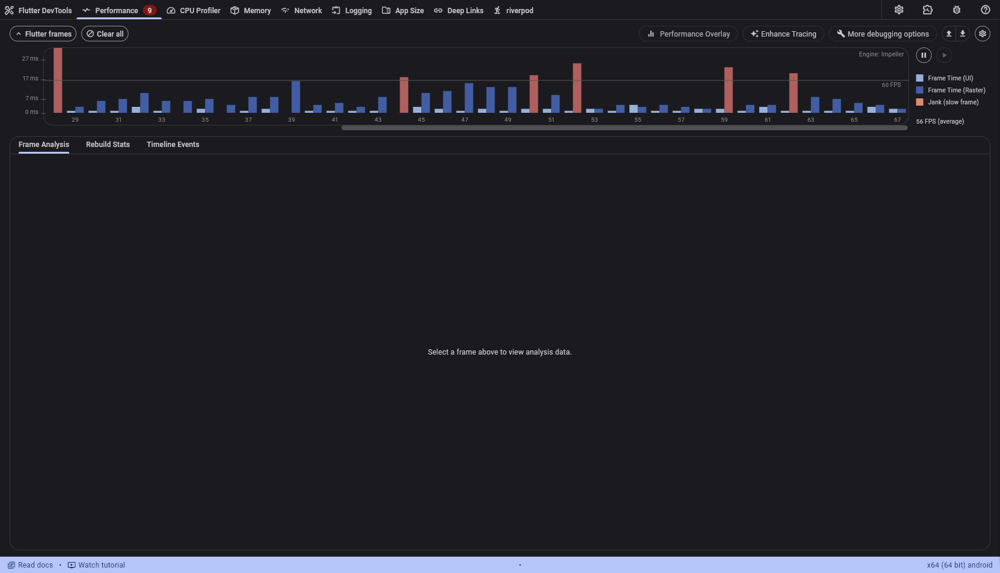
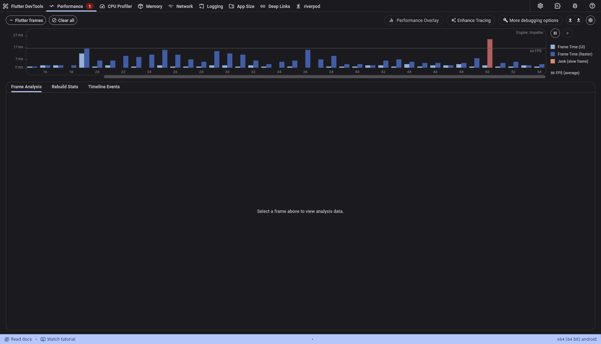
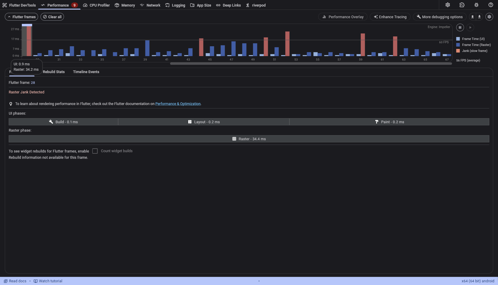
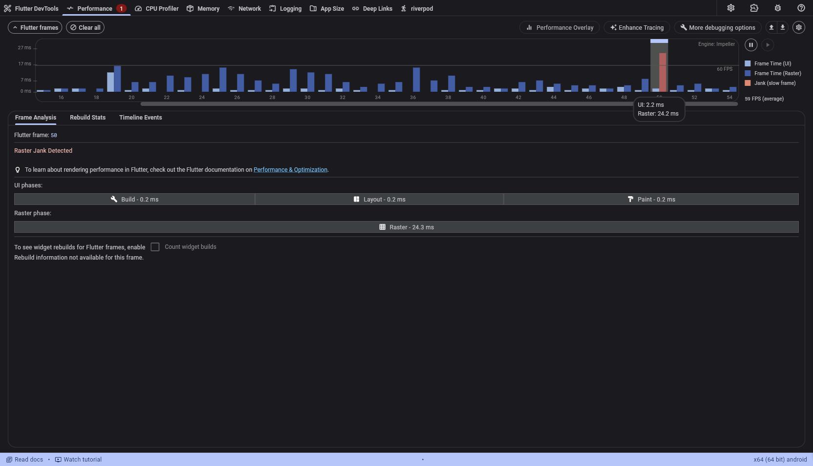

# Week 11 - Performance Optimization

Optimasi performa aplikasi `campus_notify` pada proyek
[Minggu11/campus_notify](../../Minggu11/campus_notify). Semua perubahan diukur
pada emulator Android dengan profiler yang sama sebelum dan sesudah, lalu
didokumentasikan lengkap di:

- [docs/performance-findings.md](docs/performance-findings.md) — temuan awal
  dan cara pengukurannya.
- [docs/performance-report.md](docs/performance-report.md) — laporan
  perbandingan sebelum/sesudah beserta screenshot.
- [docs/ai-verification-checklist.md](docs/ai-verification-checklist.md) —
  daftar periksa verifikasi usulan AI (yang diterima dan yang ditolak).
- [docs/before-metrics.json](docs/before-metrics.json) dan
  [docs/after-metrics.json](docs/after-metrics.json) — angka mentah dari
  Dart VM Service.
- [lib/](lib) — salinan file sumber yang dioptimasi.

## Ringkasan Hasil

| Metrik (probe scroll, window identik) | Sebelum | Sesudah |
|---|---|---|
| Frame jank (tab Performance) | 9 | **1** |
| FPS rata-rata | 56 | **59** |
| Frame time terburuk (raster) | 34,4 ms | **24,3 ms** |
| Heap usage setelah skenario | 17,35 MB | **12,52 MB** |
| Total frame skenario | 1353 | 1323 |

Rincian metrik, screenshot, dan pembatasannya ada di
[docs/performance-report.md](docs/performance-report.md).

## Bukti Visual

Frame chart DevTools pada window yang sama (daftar dibuka → satu swipe 900 ms
→ chart dibekukan). Badge pada tab Performance menunjukkan jumlah frame jank.

| Sebelum — 9 frame jank, 56 FPS | Sesudah — 1 frame jank, 59 FPS |
|---|---|
|  |  |

| Sebelum — Frame Analysis, raster 34,4 ms | Sesudah — Frame Analysis, raster 24,3 ms |
|---|---|
|  |  |

## Yang Dioptimasi

| # | Optimasi | File | Efek |
|---|---|---|---|
| O1 | Cache repository TTL (30 detik) untuk daftar dan detail + `forceRefresh` | `lib/features/announcements/data/repositories/announcement_repository_impl.dart` | Detail dilayani dari cache tanpa round trip baru (hemat 180 ms per navigasi detail) |
| O2 | Satu instance `GoRouter` dengan `refreshListenable` + `ref.listen` (bukan `ref.watch` di provider) | `lib/app/router.dart` | Perubahan status auth tidak lagi membangun ulang seluruh stack halaman |
| O3 | Hapus `shrinkWrap: true`, tambah `ValueKey(note.id)` | `lib/features/notes/presentation/pages/notes_page.dart` | Daftar catatan dibangun lazy; hanya item terlihat yang di-build |
| O4 | Pisahkan isi daftar dari `Scaffold`/`AppBar`, `const` widget, `RepaintBoundary` pada kartu token | `lib/features/announcements/presentation/pages/announcements_page.dart`, `lib/pages/home_page.dart` | Scope rebuild mengecil; item list immutable dengan `ValueKey` dan `addAutomaticKeepAlives: false` |
| O5 | `select()` untuk jumlah pengumuman + pemisahan widget | `lib/features/announcements/presentation/pages/announcements_page.dart` | Judul app bar tidak dibangun ulang saat data berubah |
| O6 | Hapus file mati `lib/core/providers.dart` dan `lib/pages/announcement_page.dart` | — | Kode lebih kecil, tidak ada sumber kebenaran ganda |

## Cara Mereproduksi

```bash
cd Minggu11/campus_notify
flutter pub get
flutter analyze          # No issues found!
flutter test             # 15 test lulus

# pengukuran (butuh emulator Android + Chrome untuk DevTools)
flutter run --profile -d emulator-5554
# lalu buka DevTools dari URL yang dicetak flutter run:
#   http://127.0.0.1:<port>/<token>/devtools/?uri=ws://127.0.0.1:<port>/<token>/ws
```

Skenario yang dipakai pada kedua build dijelaskan di
[docs/performance-report.md](docs/performance-report.md). Skrip pengukuran
(Chrome DevTools Protocol + `adb` + Dart VM Service) ada di direktori
pekerjaan lokal, tidak disertakan dalam repo.

## Pemeriksaan

```text
flutter analyze
No issues found!

flutter test
00:02 +15: All tests passed!
```

- [x] Minimal tiga optimasi nyata diterapkan (enam optimize: O1–O6).
- [x] Profil sebelum dan sesudah diambil dengan alat yang sama (Flutter
      DevTools Performance tab + Dart VM Service + `adb`).
- [x] Screenshot sebelum/sesudah disimpan di [screenshots/](screenshots).
- [x] `flutter analyze` bersih.
- [x] `flutter test` hijau (15 test, termasuk test cache repository baru).
- [x] Empat pertanyaan refleksi ditulis di bawah.

## Catatan Kebenaran

Perbaikan navigasi (rute detail dibuat sebagai child route `/pengumuman/:id`
dan `context.push` dipakai untuk membuka detail) adalah **prasyarat** agar
skenario pengukuran bisa dijalankan: pada versi sebelumnya, tombol "kembali"
dari halaman detail menutup aplikasi sehingga skenario tidak bisa diulang.
Perbaikan ini dihitung sebagai koreksi, bukan sebagai optimasi performa.

## Refleksi

1. **Temuan mana yang paling mahal, dan mengapa tooling bawaan tidak
   langsung menyadarinya?**
   Temuan yang paling mahal adalah `GoRouter` yang dibuat ulang pada setiap
   perubahan status auth (T1) dan rebuild halaman daftar yang terlalu luas
   (T3). Keduanya tidak terlihat dari `flutter analyze` maupun `flutter test`,
   karena keduanya benar secara fungsional: state tetap benar, hanya
   dikerjakan berulang. Hanya profiler yang bisa menunjukkan berapa banyak
   pekerjaan yang diulang.
2. **Mengapa pengukuran harus dilakukan pada mode yang sama (profile) dan
   dengan data yang identik?**
   Mode debug memakai JIT,counters widget build, dan instrumentasi tambahan,
   sehingga angkanya tidak bisa dibandingkan dengan mode profile. Data juga
   harus identik: dengan 2 pengumuman, biaya list dan detail tidak muncul
   sama sekali, sehingga cache dan optimasi list terlihat "mengcosmetic".
   Karena itu data sumber memakai seed 200 item yang sama untuk kedua build.
3. **Optimasi mana yang paling mudah diterapkan tetapi paling mudah dikira
   selesai?**
   Menambahkan `const` di banyak tempat. `const` membantu, tetapi biayanya
   kecil dibanding rebuild yang dipicu state provider, dan `const` sendiri
   tidak menjawab pertanyaan "siapa yang perlu dibangun ulang". Yang
   menentukan adalah pemisahan scope rebuild (O4/O5), bukan jumlah `const`.
4. **Apa yang masih belum terukur, dan bagaimana cara mengukurnya?**
   Beban thread raster emulator (18–34 ms per frame) masih mendominasi dan
   tidak bisa dipisahkan dari biaya GPU pada perangkat nyata. Build widget
   per-widget (Rebuild Stats) tidak bisa diambil pada mode profile. Untuk
   pengukuran produksi, yang dipakai adalah metric RUM/FPS dari Firebase
   Performance Monitoring atau `flutter_driver` + Integration_test pada
   perangkat fisik.
