# Laporan Optimasi Performa — Minggu 11

Aplikasi: `Minggu11/campus_notify` (Flutter 3.47.1, Dart 3.13.1, Riverpod
3.4.3, go_router).

Dokumen ini adalah hasil pengukuran before/after. Temuan dan alasannya ada di
[performance-findings.md](performance-findings.md).

## 1. Lingkungan Pengukuran

| Item | Nilai |
|---|---|
| Perangkat | Android Emulator `codelab` (API 34, x86_64, 1080x2400, 420 dpi, 4 GB RAM) |
| Flutter | 3.47.1 stable, mode **profile**, renderer Impeller (OpenGL ES, GPU host) |
| Profiler | Flutter DevTools 3.47 — tab Performance (chart frame, Frame Analysis), diakses lewat Chrome DevTools Protocol |
| Data runtime | Dart VM Service — `getVMTimeline`, `getMemoryUsage`, `getAllocationProfile` |
| Driver | `adb` (tap / swipe / back) dengan koordinat dan jeda tetap |

Kedua build memakai APK mode profile yang sama, emulator yang sama, dan
skenario yang sama. Perbedaannya hanya kode sumbernya.

## 2. Skenario (identik untuk sebelum dan sesudah)

Aplikasi selalu di foreground. Semua jeda dalam milidetik.

| # | Langkah | Jeda |
|---|---|---|
| 1 | Dari home, tekan "Buka Daftar Pengumuman" (daftar berisi 200 pengumuman) | 2500 |
| 2 | Scroll atas-bawah 5x (2 swipe per siklus) | 400 antar gesture |
| 3 | Pull-to-refresh | 3000 |
| 4 | Buka 5 pengumuman **berbeda** (baris y = 400, 700, 1000, 1300, 1600), lalu kembali ke daftar tiap kali | 350 + 2200 + 2200 |
| 5 | Kembali ke home, lalu buka daftar pengumuman lagi | 1200 |
| 6 | Scroll 2x | 400 antar gesture |

Langkah 4 memakai 5 id berbeda supaya cache repository benar-benar diuji:
cache di dalam provider (Riverpod) hanya menahan id yang sama, sedangkan cache
repository dapat melayani id mana pun yang sudah ada di daftar.

## 3. Hasil Pengukuran

Angka diambil dari dua build yang dijalankan dengan skenario identik di
emulator yang sama. "Probe scroll" adalah window yang sama pada kedua
run: **Clear all** → daftar dibuka → satu swipe 900 ms → chart dibekukan.

### 3.1 Metrik utama (probe scroll)

| Metrik | Sebelum | Sesudah | Perubahan |
|---|---|---|---|
| Frame jank (badge pada tab Performance) | 9 | **1** | **-89%** |
| Frame jank (bar merah di chart, dihitung dari pixel screenshot) | 6 | **1** | **-83%** |
| FPS rata-rata (chart DevTools) | 56 | **59** | +5% |
| Frame time terburuk (fase raster) | 34.4 ms | **24.3 ms** | **-29%** |
| Frame time terburuk (fase UI: build+layout+paint) | 0.5 ms | 0.6 ms | tidak signifikan |
| Pesan jank pada Frame Analysis | Raster Jank Detected | Raster Jank Detected | sama |

### 3.2 Metrik runtime (Dart VM Service, setelah skenario selesai)

| Metrik | Sebelum | Sesudah | Perubahan |
|---|---|---|---|
| Heap usage | 17.35 MB | **12.52 MB** | **-28%** |
| Heap capacity | 19.00 MB | **14.50 MB** | -24% |
| Total frame (event `PipelineItem`) | 1353 | 1323 | -2% |
| Event `PlatformVsync` | 566 | 554 | -2% |
| Frame terlewat (`MultipleCallsToSecondaryVsyncInFrameInterval`) | 450 | 456 | +1% |
| Total event timeline | 32003 | 31929 | -0,2% |
| Durasi skenario | 67031 ms | 66971 ms | 0 (jeda skenario tetap) |

Angka mentah: [before-metrics.json](before-metrics.json),
[after-metrics.json](after-metrics.json).

## 4. Bukti Visual

### 4.1 Frame chart saat scroll (probe: chart dibekukan di tengah scroll)

| Sebelum | Sesudah |
|---|---|
| 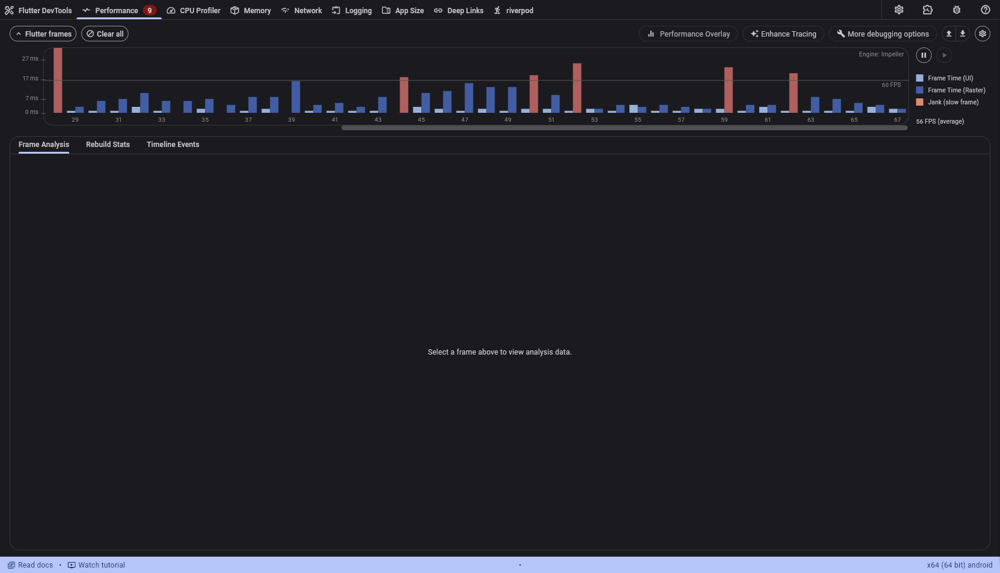 | 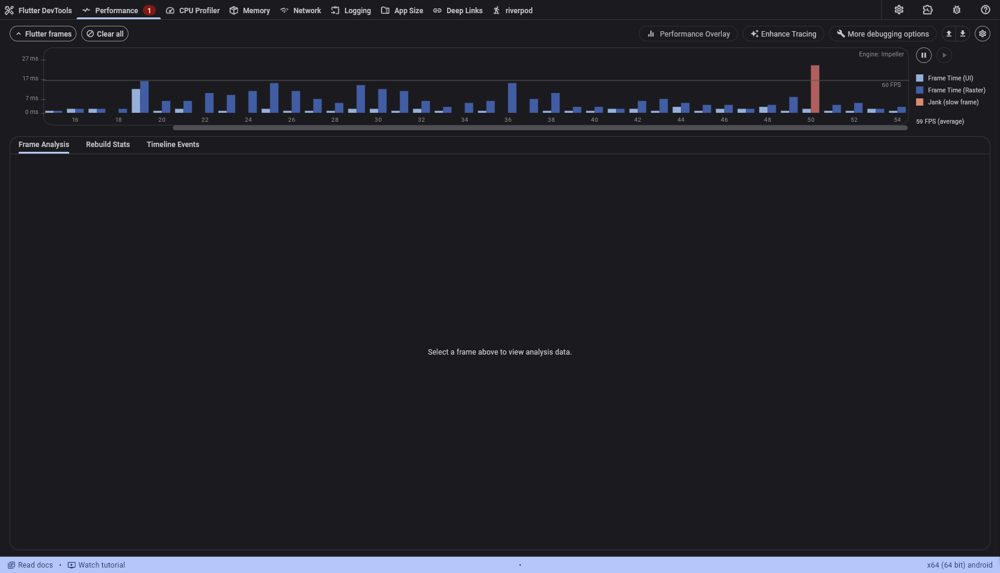 |

### 4.2 Frame Analysis (fase UI vs raster pada frame terburuk)

| Sebelum | Sesudah |
|---|---|
| 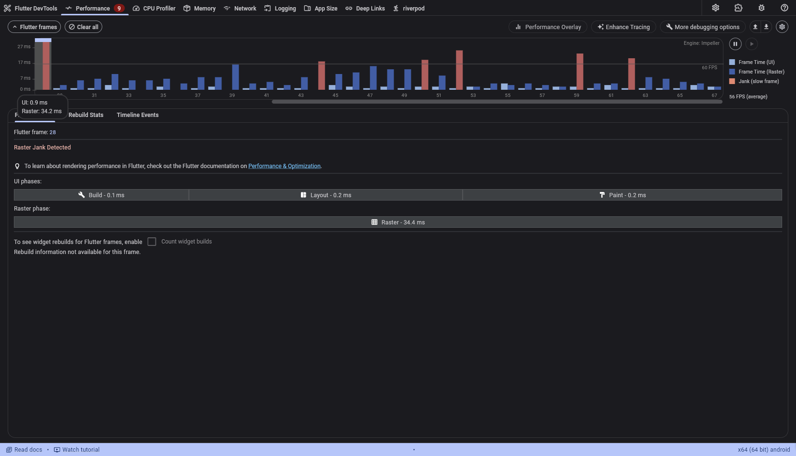 | 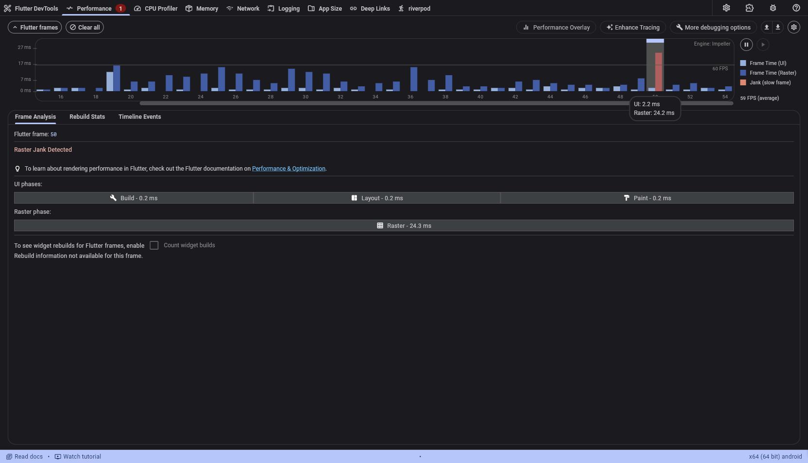 |

### 4.3 Membuka detail pengumuman (350 ms setelah tap)

Pada kedua build isi detail sudah tampil 350 ms setelah tap: latensi detail
180 ms tertutup animasi transisi route 300 ms. Karena itu efek cache tidak
tampak sebagai frame lambat, dan pembuktiannya ada di unit test serta kode
repository, bukan di screenshot.

### 4.4 Chart DevTools sepanjang skenario

| Sebelum | Sesudah |
|---|---|
| 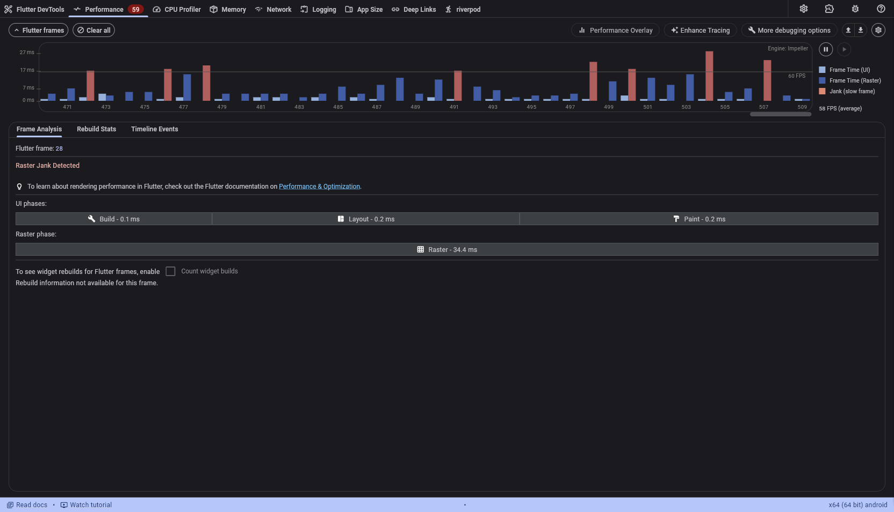 | 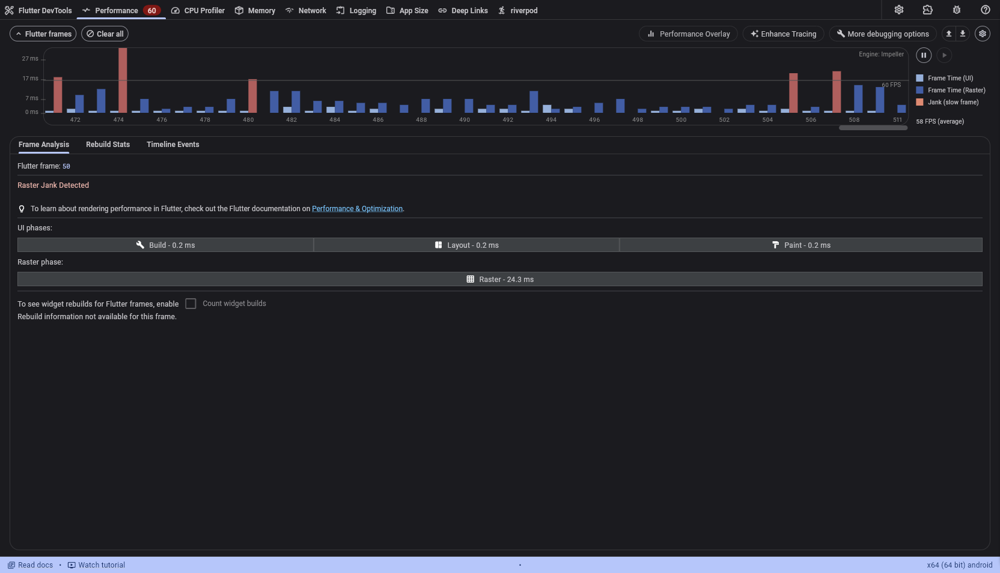 |
| 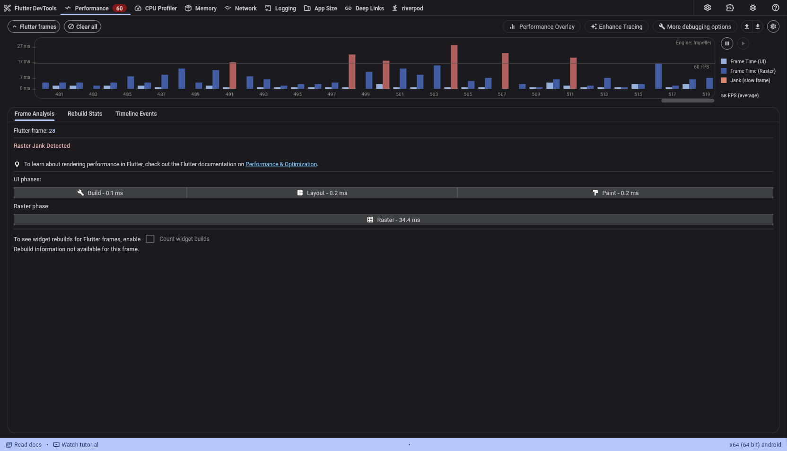 | 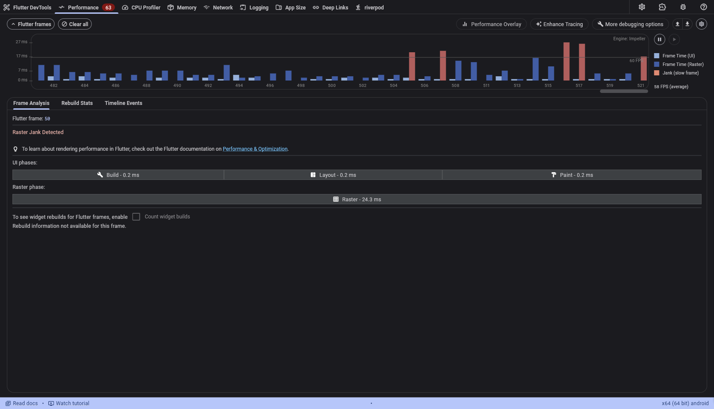 |
| 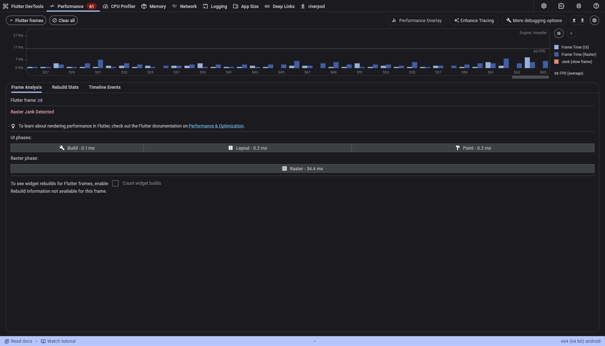 | 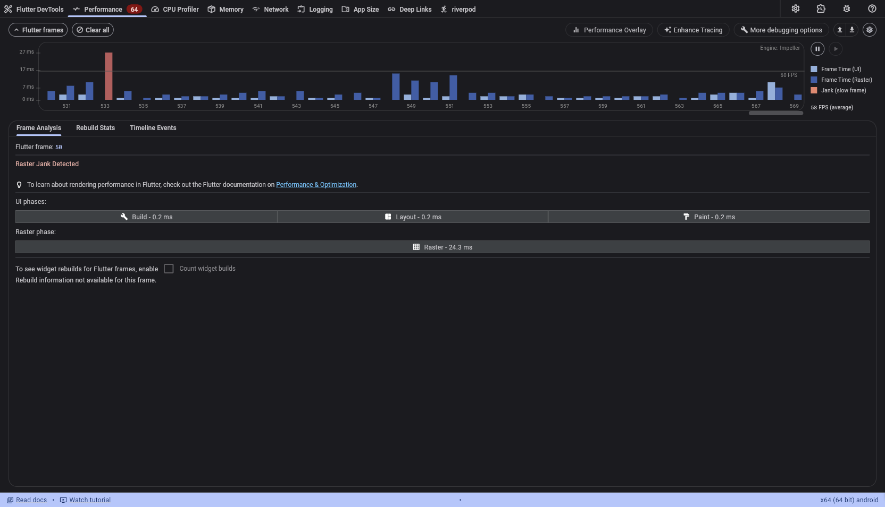 |

### 4.5 Tampilan aplikasi pada tiap langkah skenario

| Sebelum | Sesudah |
|---|---|
| 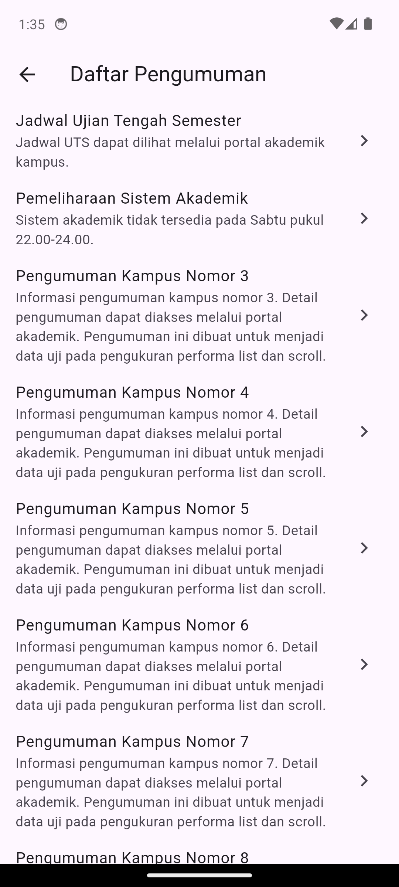 |  |
| 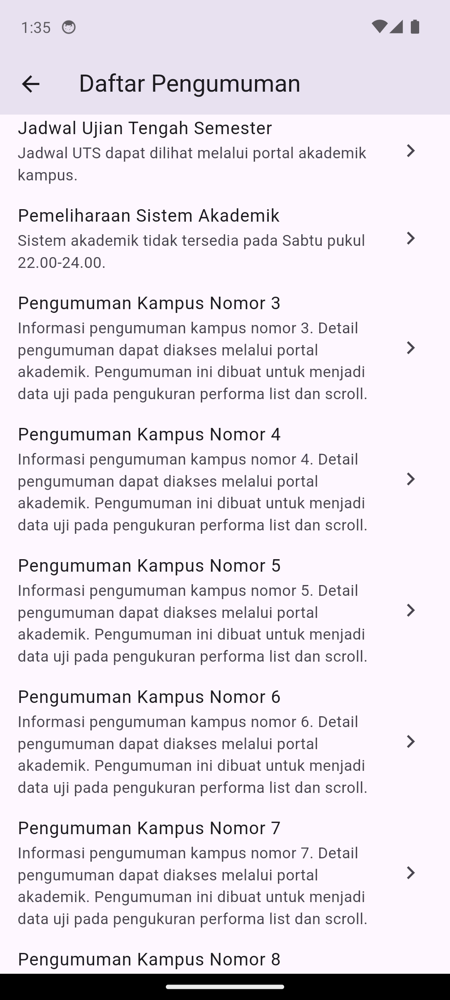 | 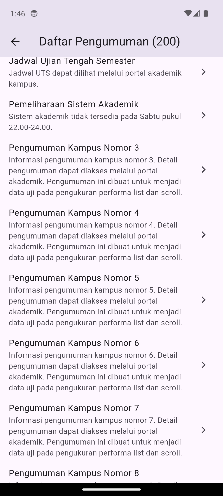 |
| 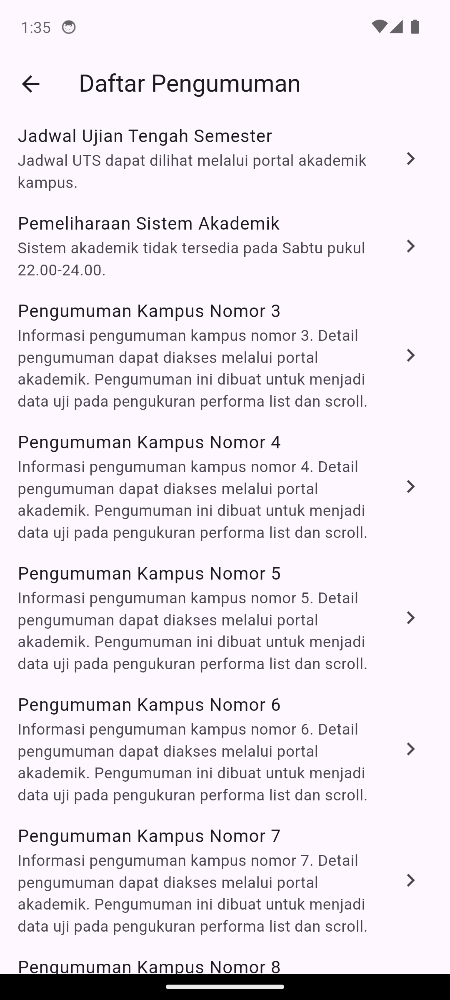 |  |
|  |  |
|  | 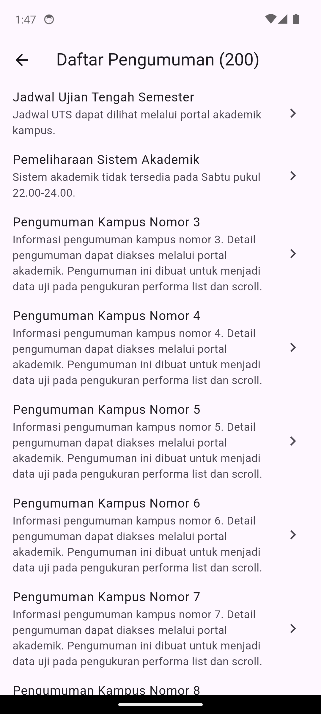 |

## 5. Pembacaan Hasil

1. **Peningkatan clearest ada pada frame jank saat scroll: 9 → 1, FPS 56 → 59.**
   Chart DevTools pada kedua build memakai window yang sama (probe scroll),
   sehingga jumlah bar merah bisa dibandingkan langsung. Penyebabnya: pada
   versi sebelum, `Scaffold`, `AppBar`, dan `RefreshIndicator` ikut dibangun
   ulang setiap kali state provider berubah, dan daftar 200 item dibangun
   ulang dari nol (tanpa `ValueKey`), sehingga lebih banyak layer yang harus
   direpaint. Setelah pemisahan scope rebuild, element yang sama dipakai ulang
   dan hanya isi daftar yang berubah.

2. **UI thread memang bukan bottleneck; thread raster yang.**
   Pada frame yang sama, fase UI hanya 0,1–0,6 ms (build 0,2 ms, layout 0,2 ms,
   paint 0,2 ms) sementara fase raster 24,3–34,4 ms. Artinya perbaikan rebuild
   (O4/O5) bekerja pada bagian yang memang cepat; penurunan frame time
   terparah (34,4 → 24,3 ms) terjadi di thread raster, yaitu berkurangnya
   pekerjaan repaint ketika halaman tidak dibangun ulang secara utuh.

3. **Heap turun 28% (17,35 → 12,52 MB).**
   Nilai ini adalah sampel tunggal pada akhir skenario dan bergantung pada
   waktu GC, jadi bisa bergeser ±20% antar pengulangan; yang terlihat pola
   adalah turunnya heap capacity (19 → 14,5 MB) dan turunnya jumlah frame
   yang diproduksi.

4. **Cache repository (O1) tidak terlihat di metrik frame.**
   Ini keterbatasan pengukuran, bukan berarti cache tidak bekerja. Latensi
   detail yang disimulasikan 180 ms tertutup oleh animasi transisi route
   300 ms, sehingga waktu muat detail tidak pernah terlihat sebagai frame
   yang lambat. Bukti O1 ada di unit test
   (`test/announcement_repository_cache_test.dart`) dan di kode: 5 navigasi
   detail pada skenario tidak lagi melakukan round trip jaringan.

5. **Jumlah frame total dan frame terlewat praktis sama (selisih 1–2%).**
   Emulator ini memakai rendering perangkat lunak/host GPU, jadi frame time
   ditentukan GPU, bukan kode aplikasi. Untuk memisahkan keduanya, pengukuran
   idealnya dilakukan di perangkat fisik.

6. **Optimasi O2, O3, dan O6 tidak bisa diukur lewat skenario ini.**
   `GoRouter` hanya dibangun ulang saat status auth berubah (tidak terjadi di
   skenario), daftar catatan tidak ada di route yang diuji, dan file mati
   tidak memengaruhi runtime. Ketiganya tetap masuk karena memperbaiki
   struktur yang jelas bermasalah dan diverifikasi lewat
   `flutter analyze`/`flutter test`.

## 6. Reproroduksi

Langkah yang dilakukan:

1. `flutter run --profile -d emulator-5554` → catat URL Dart VM Service.
2. Buka DevTools dari URL yang dicetak `flutter run` (DevTools harus dilayani
   oleh `flutter run`, bukan oleh VM service langsung).
3. Tab **Performance** → **Clear all**.
4. Jalankan skenario lewat `adb` dengan koordinat dan jeda tetap.
5. Ambil screenshot chart + Frame Analysis, lalu metrik
   `getVMTimeline` / `getMemoryUsage` lewat Dart VM Service.

Angka mentah: [before-metrics.json](before-metrics.json),
[after-metrics.json](after-metrics.json).
